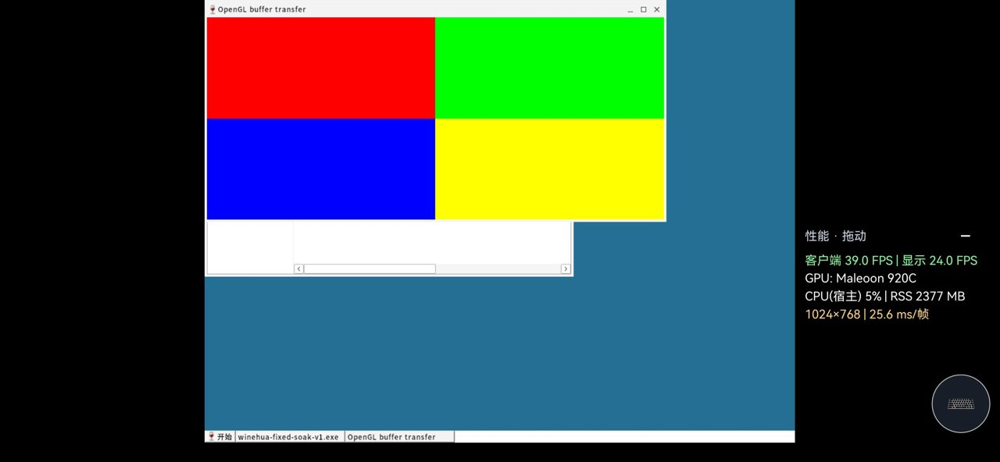
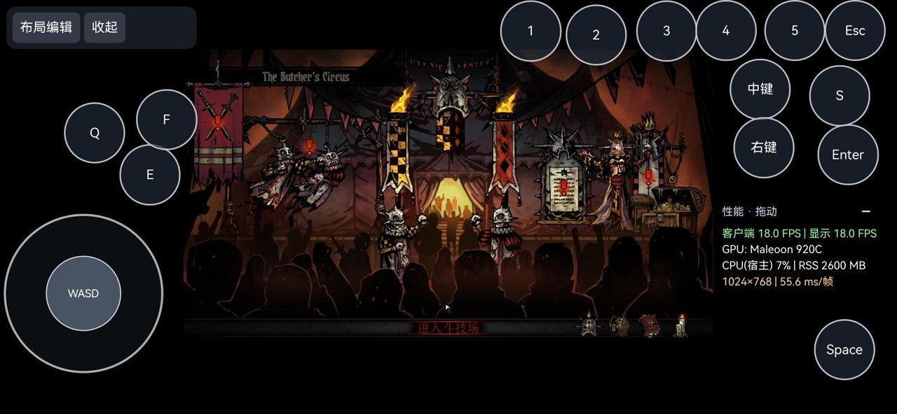
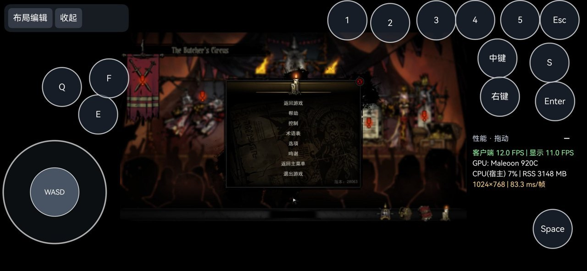

# Compatibility rollup validation

Prepared October 30, 2026. Baseline: official `master` / `3eecbd7`.
Machine-readable results: [compatibility-validation-summary.json](compatibility-validation-summary.json).

## Fresh checks on the isolated rollup snapshot

The original Windows/Linux source-snapshot reruns did not change the user's device.
Extraction-based tests inspect explicitly supplied, already-patched Wine/Mesa/VirGL source snapshots.
This is not a clean recursive-submodule checkout or a complete OHOS build from scratch.

| Area | Fresh result | What it establishes |
| --- | --- | --- |
| Windows integrated host runner | Passed, 24 stages including compile stages | Renderer/first-configure/bufferless-root, output policy, font policy, transfer/notification logic, JavaScript control/library checks and native policy tests |
| Windows outer checks | 10 passed; six Linux-only scripts explicitly skipped | Includes the integrated runner, IME, DXVK profile, syntax and four cross-compiled graphics probes; counts are stages, not ten device tests |
| Linux host rerun | All 27 compile/execution stages passed | Relevant renderer/readback/cleanup/staging and profile harnesses enable ASan/UBSan; not every stage uses sanitizers |
| IME field regression | 60 checks passed | Actual message initializers preserve scan, extended/repeat/release bits, repeat count and message type |
| Signal-handler regression | Passed on Linux | Real child exits and process-table-lock pressure through the extracted handler/monitor logic |
| Renderer teardown | Passed on Linux | Old-order UAF is reproduced as an expected failing control; fixed release orders, repeat cleanup and implicit teardown order pass |
| Shared descriptor lifecycle | Passed on Linux | Actual SCM_RIGHTS socket transfers, deferred receives and descriptor-count/cleanup checks |
| Maleoon shader workaround | Passed on Linux | Unused ShaderLayer removal; preservation of used variables/members, other builtins and malformed input |
| Zink staging reuse | Passed on Linux | Actual selector lifetime, retained/busy resources, format/capacity mismatch, disabled/oversized fallback and bounded resource count |
| ELF relocation | Passed on Linux | Dependency/table/segment constraints, idempotency, successful relocated loading and no partial update on missing dependency |
| GL and DirectDraw probes | x64 and x86 compilation passed | Valid fixture binaries can be built; these new binaries were not executed on the phone during PR preparation |
| Shell and Python syntax | Passed | Syntax of the selected build scripts and Python tools |

Linux did not have Node available. The equivalent six JavaScript/output/library/control checks
were executed in the Windows integrated suite; they are not reported as Linux executions.
The initial standalone DirectDraw compilation invocation lacked the fixture's declared Wine
programs include path. Rebuilding with the actual fixture flags passed for both architectures;
the incomplete invocation is retained locally as a harness setup correction, not a runtime defect.

## Historical device observations, kept separate from the fresh host rerun

| Historical area | Recorded observation | Limit |
| --- | --- | --- |
| GL context/entry-point bring-up | Qualified Zink core-context route and extension-gated instancing entry; native unused-capability pipeline probe changed from failure to success | Host GLES support alone does not establish Guest desktop GL support; not every creation-error path has hardware fault-injection coverage |
| DirectDraw clipping | x86 and x64 changed from 7/37 failures to 37/37 passing | Specific clip/blit/readback fixture |
| CJK text | Alias selection and legacy 16-bit mask threshold diagnosed independently; scoped monochrome path retains the recorded glyph pixels | Not all fonts, languages, explicit qualities or IME composition flows |
| Guest/Host transfer visibility | Corrected read-invalidate/write-flush profile removed the earlier large stretched-triangle corruption in the observed menu/settings frames | Not proof that all workloads or longer-running exits are fixed |
| Graphics resource cleanup | Confirmed implicit teardown UAF fixed and a subsequent cleanup path observed without that crash; sender-FD ownership separately corrected | Low-memory SIGKILLs remain a different issue |
| Desktop presentation | Fixed/auto output, startup preference snapshot, same-size restore, bufferless-root child presentation and actual GDI menu input recorded | One target device and selected cases |
| GL pixel/present probe | 1200 frames, zero pixel failures and final quadrants/orientation checked; additional simplified 6000-frame loads recorded | Different runs/configurations; not one final-rollup clean run or full real-game endurance test |
| Launch parity | Explorer/library displayed-FPS medians 65.484 / 64.524 with the same payload, 1024×768 and 64 matching drags | Short unlocked runs with different absolute character positions; no precise gain/power claim |
| Controlled input | Middle/right button pairs, modal dismissal by Enter and keyboard recovery | Guest fixture, not every game's actual dialog |
| Darkest Dungeon input | Real specified win64 executable's virtual Esc opened the arena menu; user reported recovery | Independent visual acceptance of skill keys 1–5 remains incomplete |
| v17 deployment | Signed HAP installed; both architectures' runtime/prefix imm32 DLLs and the matching manifest checked; engine ready | Built from the larger local adaptation workspace, not a fresh clean build of this review branch |

Historical package identity for reproducibility:

- v17 HAP SHA-256: `8f6008a27e01992be06c36e42b563ae04ab6aaaaae5271345df3228894dfe9a5`.
- v17 Wine payload SHA-256: `f35c1e15d192fb904832b777b2f101427940ecbf9a4e16fbd3460cbbc7332aa7`.
- x64 imm32 SHA-256: `3e0495d3a420068e9b61304ffda4804ceae1694e5bd22b5d0dd690a7e7d51e99`.
- x86 imm32 SHA-256: `e1325c0ee1896667a7cf770bd9fc15cce0451257c3af2d47bd50c71436c50ad8`.

## Selected visual evidence

The GL probe's historical final presentation has red/green above blue/yellow. This is a correctness
and presentation image, not a frame-rate benchmark:

Before the IME correction, virtual Esc events did not open the arena menu:

After correction, a short virtual Esc tap opened the menu:

Localized game/UI text in original screenshots is intentionally unchanged; the submission,
explanation, new history documents and new commit messages are in English.

## Remaining merge gates

- [ ] Clean native/Wine/Mesa/runtime/HAP rebuild from the target branch and its declared submodules.
- [ ] Complete device core, wine-vulkan, dxvk and d3d12 suites required by the project.
- [ ] Full IME composition/text-entry acceptance and independent skill-key 1–5 visual checks.
- [ ] Multiple devices, real game dialogs, window transitions and longer real-game runs.
- [ ] Route the separately identifiable product/frontend group according to the master/main-ui policy before merge.

Do not replace these gates with exit-code-only probes, Host cached-repaint FPS, old result files,
or screenshots from a different executable/runtime/profile. Preserve user data during deployment;
the known two-DLL manual migration is not a general automatic upgrade mechanism.

## Mouse-mode follow-up on October 30, 2026

The later [mouse-mode and stationary-hold change](mouse-modes-en.md) updated the working frontend,
was synchronized into the review worktree, and received a fresh signed HAP build and in-place
device installation. The updated Windows integrated runner passed all 25 stages, including the
new mouse-mode regression. All eight isolated device input checks passed. Actual Guest Windows button
messages established 1509 ms for stationary direct touch and 1498/1508/1539 ms for stationary
left/middle/right panel buttons. Relative mode preserved the cursor, moved it without clicking,
and sent a stationary left hold without requiring motion. The switch back followed the finger.

The v18 HAP SHA-256 is `514fe53daf79cfc54e3f7c22fdbda631d760da8d6f2d83a68bb3290e9f8b5845`.
It deliberately reused the verified v17 payload and native library. No uninstall or prefix reset
was performed. This is a fresh frontend/package/device check, not the full clean rebuild or the
complete core/wine-vulkan/dxvk/d3d12 suites listed as remaining gates.

The initially observed black surround had a normally painting input-audit window and zero failed
swaps in the captured renderer sample. That limited observation is not universal black-screen
acceptance; unrelated desktop recovery remains subject to the existing validation boundaries.
